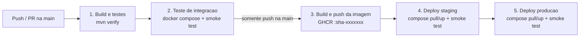
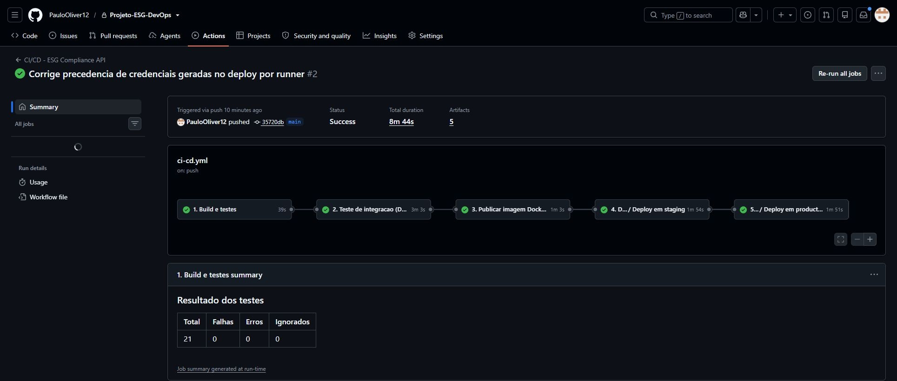
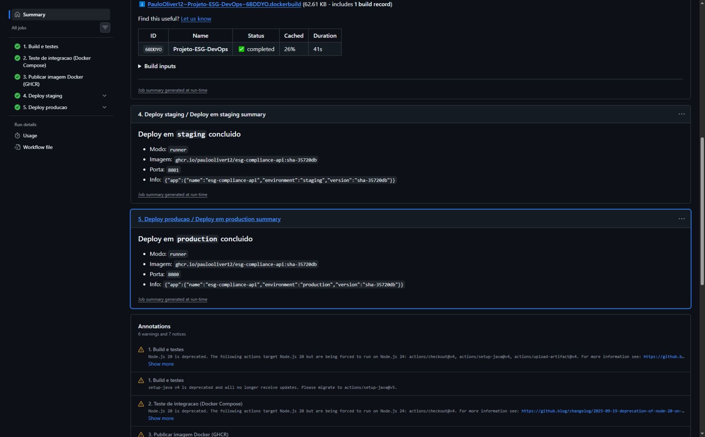
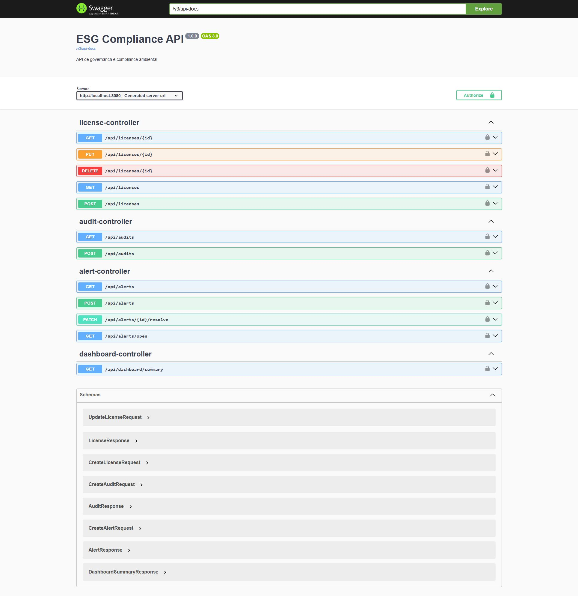

# Projeto - ESG Compliance API (Governanca e Compliance Ambiental)

API REST em Java Spring Boot para controle de licencas ambientais, auditorias internas e alertas de conformidade (tema ESG), evoluida nesta fase **"Navegando pelo mundo DevOps"** com pipeline CI/CD completo, containerizacao e orquestracao com Docker Compose, e deploy automatizado nos ambientes **staging** e **producao**.

## Integrantes

- Paulo Ricardo - RM564600
- Pedro Joaquim Garceis Paes - RM565674

## Objetivo do trabalho

Automatizar todo o ciclo de vida da aplicacao ESG desenvolvida anteriormente:

- Pipeline CI/CD (GitHub Actions) com build, testes automatizados e deploy.
- Containerizacao da API com Dockerfile multi-stage.
- Orquestracao de API + banco Oracle com Docker Compose (volumes, variaveis de ambiente e rede).
- Deploy automatizado em dois ambientes isolados: `staging` e `production`.

## Tema ESG escolhido

Governanca e compliance ambiental.

## Funcionalidades principais

- Cadastro, consulta, atualizacao e exclusao de licencas ambientais.
- Registro e consulta de auditorias internas vinculadas as licencas.
- Registro e consulta de alertas de conformidade.
- Resolucao controlada de alertas com endpoint dedicado.
- Endpoint de dashboard com indicadores operacionais.
- Validacao de payloads com Bean Validation.
- Tratamento global de excecoes.
- Controle de acesso com Spring Security, autenticacao HTTP Basic e respostas JSON para 401/403.
- Migracoes versionadas com Flyway.
- Ambiente Docker com Oracle Free e aplicacao Spring Boot.
- Carga inicial de dados para demonstracao.

## Endpoints

### Licencas ambientais

- `GET /api/licenses`
- `GET /api/licenses/{id}`
- `POST /api/licenses`
- `PUT /api/licenses/{id}`
- `DELETE /api/licenses/{id}`

### Auditorias

- `GET /api/audits`
- `POST /api/audits`

### Alertas

- `GET /api/alerts`
- `GET /api/alerts/open`
- `POST /api/alerts`
- `PATCH /api/alerts/{id}/resolve`

### Dashboard

- `GET /api/dashboard/summary`

## Regras implementadas

- Uma licenca nao pode ser cadastrada com data de expiracao anterior ou igual a data de emissao.
- O codigo da licenca deve ser unico.
- Auditorias devem ser agendadas para uma data atual ou futura.
- Alertas podem ser marcados como resolvidos por endpoint especifico.

## Perfis de acesso

Usuarios padrao do ambiente **local**. No workflow de staging e producao, as senhas vem de GitHub Secrets ou sao geradas aleatoriamente para o runner. O perfil production exige variaveis, mas o Compose base tem fallbacks locais: substitua-os ao executar fora do workflow.

| Usuario | Senha (local) | Permissao |
|---|---|---|
| `admin` | `Admin@123` | CRUD completo de licencas, auditorias e alertas |
| `auditor` | `Auditor@123` | Leitura geral, criacao de auditorias e alertas |
| `analyst` | `Analyst@123` | Leitura geral |

## Estrutura do projeto

```
Projeto-ESG-DevOps/
├── .github/workflows/
│   ├── ci-cd.yml               # Pipeline principal (build, testes, imagem, deploys)
│   └── deploy.yml              # Workflow reutilizavel de deploy (staging/producao)
├── docs/prints/                # Evidencias (prints) do pipeline e dos ambientes
├── scripts/
│   ├── smoke-test.sh           # Verificacao pos-deploy (health, info, seguranca, swagger)
│   └── setup-server.sh         # Preparacao do servidor Linux (Docker + Compose)
├── src/main/                   # Codigo-fonte da API + migracoes Flyway
├── src/test/                   # Testes automatizados (JUnit 5, Mockito, MockMvc)
├── Dockerfile                  # Imagem multi-stage da API
├── docker-compose.yml          # Orquestracao base (API + Oracle) usada em todos os ambientes
├── docker-compose.override.yml # Ajustes apenas para execucao local (build + porta do banco)
├── .env.example                # Modelo de variaveis de ambiente
├── PASSO-A-PASSO.md            # Guia detalhado de execucao e deploy
└── pom.xml
```

## Como executar localmente com Docker

Pre-requisito: Docker Desktop (ou Docker Engine + Compose v2) com ao menos 4 GB de memoria disponivel.

```bash
# 1. Criar o arquivo de variaveis a partir do modelo
cp .env.example .env          # Windows PowerShell: Copy-Item .env.example .env

# 2. Construir a imagem e subir API + Oracle
docker compose up -d --build

# 3. Acompanhar a inicializacao (o Oracle leva 1-3 min na primeira vez)
docker compose ps
docker compose logs -f app

# 4. Testar
curl http://localhost:8080/actuator/health
curl http://localhost:8080/actuator/info
curl -u analyst:Analyst@123 http://localhost:8080/api/dashboard/summary

# 5. Derrubar (use -v para apagar tambem o volume do banco)
docker compose down
```

Servicos disponiveis:

- API: `http://localhost:8080`
- Swagger UI: `http://localhost:8080/swagger-ui.html`
- Health check: `http://localhost:8080/actuator/health`
- Ambiente/versao: `http://localhost:8080/actuator/info`
- Oracle Free: `localhost:1521`, service name `FREEPDB1`

### Variaveis de ambiente

| Variavel | Descricao | Padrao local |
|---|---|---|
| `COMPOSE_PROJECT_NAME` | Isola containers, rede e volume por ambiente | `esg-local` |
| `APP_ENV` | Ambiente e perfil Spring (`local`, `staging`, `production`) | `local` |
| `APP_VERSION` | Versao exibida em `/actuator/info` | `local` |
| `APP_IMAGE` | Imagem da API | `esg-compliance-api:local` |
| `APP_PORT` / `DB_PORT` | Portas publicadas no host | `8080` / `1521` |
| `ORACLE_PASSWORD` | Senha do SYS do Oracle | `Oracle123` |
| `DB_USERNAME` / `DB_PASSWORD` | Usuario da aplicacao no banco | `projetof` / `projetof123` |
| `ADMIN_PASSWORD`, `AUDITOR_PASSWORD`, `ANALYST_PASSWORD` | Senhas dos usuarios da API | ver tabela de perfis |
| `JAVA_OPTS` | Opcoes da JVM | `-XX:MaxRAMPercentage=75.0` |

### Executando sem Docker (Maven)

Requer Java 21, Maven e um Oracle acessivel em `localhost:1521`.

```bash
mvn test                 # apenas testes automatizados (nao precisam de banco)
mvn spring-boot:run
```

## Pipeline CI/CD

**Ferramenta:** GitHub Actions. **Registry de imagens:** GitHub Container Registry (GHCR). **Destino escolhido:** runner do GitHub Actions (ambientes temporarios). O modo SSH em servidor Linux permanece como opcao implementada.



| Etapa | Job | O que faz |
|---|---|---|
| 1 | `build-test` | Configura Java 21 com cache Maven, executa `mvn clean verify` (compilacao + testes JUnit/Mockito/MockMvc), gera resumo dos testes e publica relatorios e o `.jar` como artefatos. |
| 2 | `integration-test` | Sobe a stack real (API + Oracle) com Docker Compose no runner e executa `scripts/smoke-test.sh` (health UP, ambiente correto, 401 sem credenciais, Swagger, endpoint autenticado). |
| 3 | `publish-image` | Gera a imagem com o `Dockerfile` e publica no GHCR com as tags `sha-<commit>` e `latest`. |
| 4 | `deploy-staging` | Usa o environment `staging`: gera o `.env` do ambiente e faz `docker compose pull` + `up -d` da imagem publicada, seguido do smoke test. Funciona em dois modos (veja abaixo). |
| 5 | `deploy-production` | So executa se staging passou. Usa o environment `production` (pode exigir aprovacao manual) e implanta **a mesma imagem** validada em staging. |

### Modos de deploy

O workflow reutilizavel `.github/workflows/deploy.yml` escolhe o modo automaticamente, por ambiente:

| Modo | Quando | Como funciona |
|---|---|---|
| **servidor** | O environment tem os secrets `SSH_HOST`, `SSH_USER` e `SSH_PRIVATE_KEY` | Copia `docker-compose.yml` + `.env` via SSH para a VM (ex.: Azure), executa `docker compose pull` + `up -d` e roda o smoke test no servidor. O ambiente fica no ar e acessivel pelo navegador. |
| **runner** | Esses secrets nao foram cadastrados | Sobe o mesmo `docker-compose.yml` com a imagem do GHCR no proprio runner do GitHub Actions, roda o smoke test e publica as evidencias (containers, health, info e log da API) como artefato `evidencias-<ambiente>`. O ambiente existe durante a execucao. |

Assim o pipeline completo (build -> testes -> imagem -> staging -> producao) roda logo no primeiro push, e passa a publicar na VM assim que os secrets de SSH forem cadastrados, sem mudar nenhum arquivo.

Regras de execucao:

- **Pull Request para `main`:** executa apenas as etapas 1 e 2 (validacao).
- **Push/merge na `main`:** executa todas as etapas (build -> testes -> imagem -> staging -> producao).
- O deploy usa a imagem identificada pela tag de commit `ghcr.io/<usuario>/esg-compliance-api:sha-<commit>`, reutilizando a mesma referencia de imagem em staging e producao. Tags podem ser sobrescritas; a fixacao por digest e uma melhoria futura.
- Cada ambiente roda como um projeto Compose separado (`esg-staging` e `esg-production`), com rede, volume de banco, porta e segredos proprios.

### Configuracao necessaria no GitHub

O job de publicacao ja declara `packages: write`. Se uma politica do repositorio ou da organizacao bloquear o GHCR, revise as permissoes efetivas em Settings -> Actions -> General. A aprovacao manual depende de Required reviewers no environment production; nao e imposta apenas pelo YAML.

Para o deploy em **servidor**, em **Settings -> Environments**, crie os environments `staging` e `production` e cadastre em cada um (no modo **runner** nada disso e necessario; senhas nao cadastradas sao geradas aleatoriamente a cada execucao):

| Tipo | Nome | Exemplo / descricao |
|---|---|---|
| Secret | `SSH_HOST` | IP ou DNS do servidor |
| Secret | `SSH_USER` | Usuario SSH (ex.: `azureuser`) |
| Secret | `SSH_PRIVATE_KEY` | Chave privada SSH com acesso ao servidor |
| Secret (opcional) | `SSH_KNOWN_HOSTS` | Saida de `ssh-keyscan <host>` (se ausente, e obtido automaticamente) |
| Secret | `ORACLE_PASSWORD` | Senha do SYS do Oracle |
| Secret | `DB_PASSWORD` | Senha do usuario `projetof` no banco |
| Secret | `ADMIN_PASSWORD`, `AUDITOR_PASSWORD`, `ANALYST_PASSWORD` | Senhas dos usuarios da API |
| Variable | `APP_PORT` | `8081` em staging, `8080` em producao |
| Variable | `APP_URL` | URL publica, ex.: `http://<ip>:8081/swagger-ui.html` |
| Variable (opcional) | `SSH_PORT`, `JAVA_OPTS` | Padrao `22` e `-Xms256m -Xmx512m` |

A execucao documentada promoveu staging para production automaticamente. Se a atividade exigir aprovacao manual, configure **Required reviewers** no environment `production`, quando disponivel no plano.

> Use senhas apenas com letras, numeros e `@` / `_` (restricao do Oracle e do arquivo `.env`).

### Preparacao do servidor

Servidor Linux Ubuntu 22.04/24.04 (ex.: VM Azure for Students) com portas `22`, `8080` e `8081` liberadas. Recomendado **8 GB de RAM** para staging e producao na mesma VM (sao dois Oracle), ou duas VMs de 4 GB (uma por environment, cada uma com seu `SSH_HOST`).

```bash
scp scripts/setup-server.sh usuario@servidor:~
ssh usuario@servidor 'bash setup-server.sh'
```

## Containerizacao

### Dockerfile

```dockerfile
# ---------- Etapa 1: build ----------
FROM maven:3.9.9-eclipse-temurin-21 AS build
WORKDIR /app

# Camada separada para cache das dependencias (so e refeita quando o pom.xml muda)
COPY pom.xml .
RUN mvn -q -B dependency:go-offline

COPY src ./src
# Os testes rodam na etapa "Build e testes" do pipeline, antes da imagem ser gerada
RUN mvn -q -B -DskipTests clean package

# ---------- Etapa 2: runtime ----------
FROM eclipse-temurin:21-jre-alpine

ARG APP_VERSION=local
LABEL org.opencontainers.image.title="esg-compliance-api" \
      org.opencontainers.image.description="API REST de governanca e compliance ambiental (ESG)" \
      org.opencontainers.image.version="${APP_VERSION}"

RUN addgroup -S app && adduser -S app -G app
WORKDIR /app

COPY --from=build /app/target/esg-compliance-api-1.0.0.jar app.jar
RUN chown app:app app.jar
USER app

ENV APP_VERSION=${APP_VERSION} \
    JAVA_OPTS="-XX:MaxRAMPercentage=75.0"

EXPOSE 8080

HEALTHCHECK --interval=30s --timeout=5s --start-period=90s --retries=5 \
  CMD wget -qO- http://localhost:8080/actuator/health || exit 1

ENTRYPOINT ["sh", "-c", "exec java $JAVA_OPTS -jar /app/app.jar"]
```

Estrategias adotadas:

- **Multi-stage build:** o Maven/JDK ficam apenas na etapa de build; a imagem final contem o JRE Alpine e o `.jar`, sem as ferramentas de build. Nao foi medida a reducao de tamanho nesta entrega.
- **Cache de dependencias:** `pom.xml` e copiado e resolvido antes do codigo, entao alteracoes no `src` nao baixam as dependencias de novo (no CI tambem ha cache via `cache-from: type=gha`).
- **Usuario nao-root:** a aplicacao roda com o usuario `app`.
- **Healthcheck:** o Docker monitora `/actuator/health`.
- **Configuracao externa:** conexao, perfil e credenciais sao parametrizados por variaveis. Os valores locais de demonstracao devem ser substituidos; o workflow fornece credenciais geradas ou Secrets. `JAVA_OPTS` permite ajustar memoria por ambiente.
- **Versionamento:** a imagem recebe a versao (`sha-<commit>`), exposta em `/actuator/info`.

### Orquestracao (Docker Compose)

- **Servicos:** `oracle-db` (Oracle Free 23) e `app` (API). A API so inicia quando o banco esta saudavel (`depends_on: condition: service_healthy`).
- **Volume:** `oracle-data` persiste os dados do banco entre reinicializacoes e deploys.
- **Rede:** `esg-net` (bridge) isola a comunicacao; a API acessa o banco pelo nome `oracle-db`. Em staging/producao a porta do banco **nao** e exposta no host.
- **Variaveis de ambiente:** lidas do `.env` (local) ou do `.env` gerado pelo pipeline a partir dos Secrets (staging/producao).
- **Override local:** `docker-compose.override.yml` e carregado automaticamente apenas no ambiente local, adicionando o `build` da imagem e a porta do Oracle.

Comandos uteis:

```bash
docker build -t esg-compliance-api:local .          # construir apenas a imagem
docker compose up -d --build                         # subir ambiente local
docker compose -p esg-staging ps                     # status de staging no servidor
docker compose -p esg-production logs -f app         # logs de producao no servidor
```

## Testes automatizados

| Classe | Tipo | Cobertura |
|---|---|---|
| `LicenseServiceTest` | Unitario (Mockito) | Criacao, validacao de datas, codigo duplicado, update, 404, filtro |
| `AlertServiceTest` | Unitario (Mockito) | Criacao, resolucao, alerta ja resolvido, 404 |
| `AuditServiceTest` | Unitario (Mockito) | Agendamento futuro e rejeicao de data passada |
| `DashboardServiceTest` | Unitario (Mockito) | Agregacao dos indicadores |
| `LicenseControllerSecurityTest` | Web/Seguranca (MockMvc) | 401, 403, 201, 400, 404 e perfis de acesso |

Alem disso, o job `integration-test` e o smoke test pos-deploy validam a aplicacao rodando de verdade com o Oracle.

## Prints do funcionamento

Documentacao tecnica: [PDF](docs/Documentacao-Tecnica-ESG-DevOps.pdf).

Repositorio **privado**: [PauloOliver12/Projeto-ESG-DevOps](https://github.com/PauloOliver12/Projeto-ESG-DevOps).

### Pipeline completo aprovado

[Execucao #2 no GitHub Actions](https://github.com/PauloOliver12/Projeto-ESG-DevOps/actions/runs/38474933261), em 13/10/2026, commit `35720db097f427cdaa9678af685a9d498d8d70a9`.

| Etapa | Resultado |
|---|---|
| Build e testes | 21 testes; 0 falhas; 0 erros; 0 ignorados |
| Integracao com Oracle | Smoke test aprovado; containers healthy; 2 migracoes aplicadas |
| Publicacao GHCR | `ghcr.io/paulooliver12/esg-compliance-api:sha-35720db` |
| Staging no runner | Smoke test aprovado; health UP; environment staging |
| Producao no runner | Smoke test aprovado; health UP; environment production |





O pacote do GHCR e privado. Os deploys utilizaram a mesma referencia de imagem e informaram `version: sha-35720db`. A promocao para production foi automatica apos staging, sem aprovacao manual.

A primeira execucao revelou uma divergencia de credenciais no runner. A causa e a correcao do workflow estao registradas em [correcao-deploy.md](docs/evidencias/github/correcao-deploy.md); os resultados desta entrega pertencem a execucao #2, apos a correcao.

Metadados, identificadores e hashes dos artefatos: [resultado-ci.json](docs/evidencias/github/resultado-ci.json). Evidencias originais: [staging](docs/evidencias/github/staging/) e [production](docs/evidencias/github/production/). Log resumido da integracao: [integration.log](docs/evidencias/github/integration.log).

### Validacao local de 13/10/2026

Foram executadas 10 verificacoes HTTP, todas com o status esperado. Health retornou UP; info identificou o ambiente local; endpoints sem credenciais ou com senha incorreta retornaram 401; consultas autenticadas, OpenAPI e Swagger responderam.



Respostas originais e horario de coleta: [checks.json](docs/evidencias/local/checks.json). Os arquivos nao incluem senhas nem cabecalhos de autenticacao.

### Suite automatizada

Os 21 testes foram executados pelo Maven no GitHub Actions e todos passaram. Os cinco XML originais estao em [surefire-reports](docs/evidencias/github/surefire-reports/), extraidos do artefato `relatorios-testes`. O SHA-256 do ZIP baixado confere com o digest publicado pelo GitHub.

Com Docker Desktop ativo, rode em um PowerShell normal:

```powershell
.\scripts\validar-entrega.ps1
```

O script roda Maven em container, salva os relatorios em `docs/evidencias/validacao-local`, consulta a API e preserva os containers existentes. Nao faz commit, push ou deploy.

### Alcance da validacao

No modo runner nao existe URL publica permanente para staging/producao. Os ambientes existem durante o job. Nao interpretar jobs ignorados como deploy bem-sucedido.

## Tecnologias utilizadas

- **Aplicacao:** Java 21, Spring Boot 3.3, Spring Web, Spring Data JPA, Spring Validation, Spring Security, Spring Boot Actuator, Springdoc OpenAPI (Swagger)
- **Banco de dados:** Oracle Database Free 23 + Flyway (migracoes versionadas)
- **Testes:** JUnit 5, Mockito, AssertJ, Spring MockMvc, Spring Security Test
- **Build:** Maven
- **Containers:** Docker (multi-stage), Docker Compose
- **CI/CD:** GitHub Actions, GitHub Environments (staging/production), GitHub Container Registry (GHCR)
- **Infraestrutura:** deploy via SSH em servidor Linux (Ubuntu) com Docker, ou no runner do GitHub Actions

## Estrutura de banco

As tabelas sao criadas por Flyway em `src/main/resources/db/migration/V1__init.sql`.
Os dados iniciais de demonstracao sao inseridos em `src/main/resources/db/migration/V2__seed_data.sql`.

## Checklist de entrega

Conferido em 13/10/2026 com os requisitos e os artefatos de entrega apresentados no enunciado da Fase 6 - Desafio DevOps. O PDF contempla os seis topicos solicitados, incluindo integrantes, pipeline, Docker, prints de execucao, os dois ambientes e desafios resolvidos.

Staging e production foram implantados e verificados em runners temporarios. Os prints fornecidos do enunciado nao exigem Azure nem uma URL publica permanente. Como o repositorio e privado, o avaliador precisa receber o ZIP ou obter acesso autorizado ao GitHub.

| Item solicitado no enunciado | OK | Onde verificar |
|---|:---:|---|
| Projeto compactado em .ZIP com estrutura organizada | OK | Projeto-ESG-DevOps-Entrega.zip; codigo, scripts, configuracoes e .env.example incluidos |
| Dockerfile funcional | OK | Dockerfile; build, integracao e deploys concluidos na execucao #2 |
| docker-compose.yml ou arquivos Kubernetes | OK | docker-compose.yml; API + Oracle, volume, variaveis e rede |
| Pipeline com etapas de build, teste e deploy | OK | .github/workflows/; cinco etapas aprovadas e 21 testes sem falhas |
| README.md com instrucoes e prints | OK | Instrucoes de execucao e secao Prints do funcionamento acima |
| Documentacao tecnica com evidencias (PDF ou PPT) | OK | docs/Documentacao-Tecnica-ESG-DevOps.pdf; seis topicos solicitados |
| Deploy realizado nos ambientes staging e producao | OK | Execucao #2; health UP, environment correto e smoke test em ambos |
